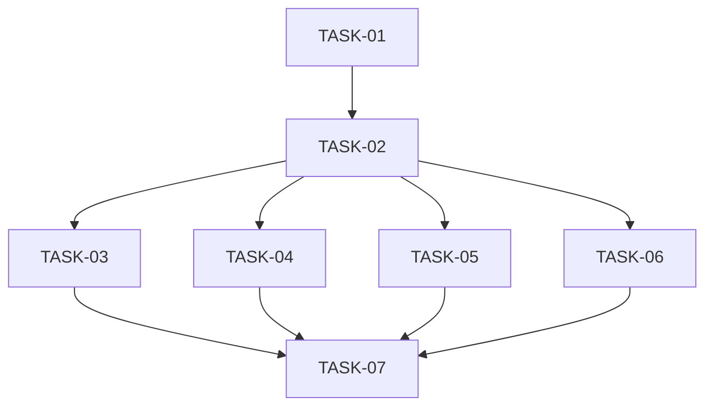

# Task Summary — Nagar Sarthi

**Last Updated:** 2026-11-21
**Overall Progress:** 0 / 7 tasks complete (0%)
**Current Task:** TASK-01
**Source Documents:** `docs/ideas/2026-11-21-nagar-sarthi-prd.md`

## How to use this plan

Read this file first in any session. Then open only the task file you are executing. The task files are self-contained; open the PRD only at the section a task names.

## Status Board

| Task | Title | Status | Priority | Size | Depends On | Progress |
|---|---|---|---|---|---|---|
| TASK-01 | Audit Engine and Scores | Not Started | P0 | L | None | 0% |
| TASK-02 | Backend, App Shell and Money Map | Not Started | P0 | L | TASK-01 | 0% |
| TASK-03 | Officer Flow: Money Trail, Flags, Recovery Notice, Next Rupee | Not Started | P0 | M | TASK-02 | 0% |
| TASK-04 | Play the Monsoon: Time Slider and Complaints Heat | Not Started | P1 | M | TASK-02 | 0% |
| TASK-05 | Corporator Flow: Fair Scorecards and Ward Brief | Not Started | P0 | M | TASK-02 | 0% |
| TASK-06 | Citizen Flow: Raise, Track, Share, Ask | Not Started | P1 | M | TASK-02 | 0% |
| TASK-07 | Sign-in, Languages and Demo Readiness | Not Started | P2 | M | TASK-03, TASK-04, TASK-05, TASK-06 | 0% |

Status vocabulary: `Not Started`, `In Progress`, `Blocked`, `In Review`, `Complete`.

## Execution Order

1. TASK-01 → 2. TASK-02 → 3. TASK-03 → 4. TASK-04 → 5. TASK-05 → 6. TASK-06 → 7. TASK-07

**Ready now (dependencies satisfied):** TASK-01
**Blocked:** none

TASK-03, TASK-04, TASK-05 and TASK-06 each depend only on TASK-02, so any one can be dropped or reordered without breaking the others.

## Time budget and cut order

About 3 hours of build time against roughly 3 h 40 min of planned work, before the full quality bar chosen for these tasks is counted. Cut in this order (PRD §9):

1. Report a failed fix (TASK-07 stretch)
2. Sign-in becomes a role picker (TASK-07)
3. Hindi and Marathi interface (TASK-07)
4. Plain complaint form (TASK-06)
5. Complaints heat layer (TASK-04)

Never cut: audit engine, money map with ward and road layers, recovery notices, next-rupee list.

## Dependency Graph

## Requirement Coverage

| Category | Requirements | Covered | Uncovered |
|---|---|---|---|
| Functional (REQ-F) | 38 | 38 | — |
| Data (REQ-D) | 5 | 5 | — |
| Non-Functional (REQ-N) | 8 | 8 | — |
| Security (REQ-S) | 5 | 5 | — |
| Operational (REQ-O) | 2 | 2 | — |

Full mapping: [requirements-registry.md](./requirements-registry.md)

## Progress Management Protocol

After each completed implementation and its commit:

1. Update the task file: progress log row (date, what landed, commit ref), `Status`, and the completion checklist.
2. Update this file: task status, overall progress, current task, newly unblocked tasks.
3. Update `requirements-registry.md` if coverage moved between tasks.
4. Re-run `python3 scripts/validate_tasks.py docs/tasks/` and fix anything it reports.

A task is `Complete` only when its acceptance criteria have been verified in the running application, not when the code is written.

## Open Questions & Assumptions

| # | Item | Raised by | Status | Impact if wrong |
|---|---|---|---|---|
| 1 | minimum sample size is 15 jobs per contractor per ward | TASK-01 | Assumed, unconfirmed | ratings appear or disappear for small samples if wrong |
| 2 | heavy-rain week means a week containing an Orange or Red IMD alert day | TASK-01 | Assumed, unconfirmed | context discount shifts if wrong |
| 3 | risk weights are severity 30, hospital or school access 30, accidents 20, flood hotspot 10, traffic 10 | TASK-01 | Assumed, unconfirmed | ranking order changes if wrong |
| 4 | remaining budget is ward budget minus spend, floored at zero | TASK-01 | Assumed, unconfirmed | overspent wards get a ranked list with no funded items |
| 5 | ward shade is flagged rupees divided by ward spend, in five steps | TASK-02 | Assumed, unconfirmed | colours shift if a different base is wanted |
| 6 | a road's status is its most serious flag in the order DLP, failed, over rate, clean | TASK-02 | Assumed, unconfirmed | PRD lists the statuses without a tie-break |
| 7 | the relay timeout is 20 seconds before the fallback is returned | TASK-02 | Assumed, unconfirmed | PRD requires a fallback, not a number |
| 8 | a notice covers the flags of one type on one road or one ward | TASK-03 | Assumed, unconfirmed | grouping changes if officers want per-contractor notices |
| 9 | a failed fix turns red on its completion date plus 30 days, since only the re-open flag is known, not the date | TASK-04 | Assumed, unconfirmed | the animation timing is indicative |
| 10 | complaints without coordinates are placed at their locality's coordinates from localities.csv | TASK-04 | Assumed, unconfirmed | Low |
| 11 | the brief is at most 200 words | TASK-05 | Assumed, unconfirmed | the organisers' starter prompt uses 120 for a scorecard; a ward brief covers more ground |
| 12 | a match is an existing complaint of the same category in the same locality within the last 14 days | TASK-06 | Assumed, unconfirmed | PRD says matching existing complaints without a rule |
| 13 | the report card is shared as a rendered image through share_plus on Android and as a download on web | TASK-06 | Assumed, unconfirmed | Low |
| 14 | the fixed demo code is read from server config, not hardcoded in the app | TASK-07 | Assumed, unconfirmed | Low |
| 15 | sessions are signed tokens held in memory on the client; they do not survive an app restart | TASK-07 | Assumed, unconfirmed | Low |
| 16 | officer views stay in English, per the PRD | TASK-07 | Assumed, unconfirmed | Low |

## Related Documentation

| Document | Purpose |
|---|---|
| `docs/ideas/2026-11-21-nagar-sarthi-prd.md` | Product decisions, features, build order, cut order |
| `README.md` | Challenge brief and dataset overview |
| `STARTER_IDEAS.md` | Judging rubric |
| `DATA_DICTIONARY.md` | Column meanings |
| https://github.com/keyurshubham2014/saarthee-app | Source of theme, widgets and CivicMap |

## Change Log

| Date | Change |
|---|---|
| 2026-11-21 | Initial plan generated from the Nagar Sarthi PRD |
